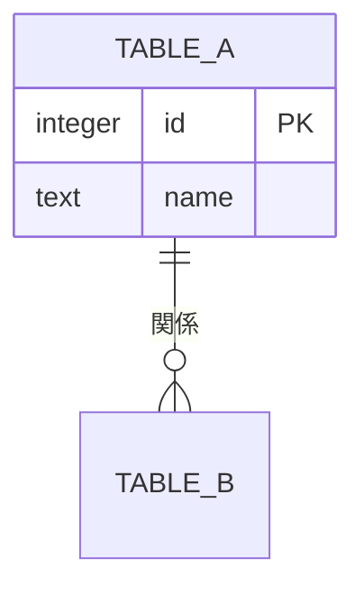

# 要件定義書

## メタ情報
| 項目 | 内容 |
|---|---|
| アプリ名 | {アプリ名} |
| バージョン | 1.0（初版） |
| 作成日 | {今日の日付} |
| ステータス | 確定 |
| 対象読者 | Claude Code（実装担当AI） |

> このドキュメントの使い方
>
> Claude Code に対して「このファイルに従ってアプリを実装してください」と渡してください。
> 追加確認なしに実装着手できる粒度で記述されています。

---

## 1. プロジェクト概要

### 1.1 背景・目的
{背景と解決課題}

### 1.2 利用者
| 種別 | 概要 | ITリテラシー |
|---|---|---|
| {種別} | {概要} | 高/中/低 |

### 1.3 利用環境
| 項目 | 内容 |
|---|---|
| OS | {Windows 10/11等} |
| ハードウェア | {PC仕様・接続機器等} |
| ネットワーク | {スタンドアロン/LAN等} |
| 配置形態 | {スタンドアロン/複数台展開等} |

---

## 2. 技術スタック

### 2.1 開発環境
| 項目 | 内容 |
|---|---|
| 言語 | {C# 12等} |
| フレームワーク | {.NET 8 / WPF等} |
| IDE | {Visual Studio 2022等} |
| アーキテクチャ | {MVVM / DIコンテナ等} |

### 2.2 主要パッケージ
| パッケージ名 | バージョン | 用途 |
|---|---|---|
| {PackageName} | {x.x.x} | {用途} |

### 2.3 ソリューション構成
```
{SolutionName}/
├── {AppName}/          # メインアプリ
│   ├── Models/
│   ├── ViewModels/
│   ├── Views/
│   └── Services/
└── {AppName}.Tests/    # テストプロジェクト（必要な場合）
```

### 2.4 命名規則
| 対象 | 規則 | 例 |
|---|---|---|
| クラス | PascalCase | MainViewModel |
| メソッド | PascalCase | LoadDataAsync |
| プロパティ | PascalCase | IsConnected |
| プライベートフィールド | _camelCase | _serialPort |
| 定数 | UPPER_SNAKE | MAX_RETRY_COUNT |

---

## 3. 機能要件

### 3.1 機能一覧
| 機能ID | 機能名 | 優先度 | 概要 |
|---|---|---|---|
| F-001 | {機能名} | Must | {概要} |

### 3.2 機能詳細

#### F-001: {機能名}

再利用判定: {使う / 拡張 / 新規}

再利用元: {プロジェクト / クラス}

トリガー: {いつ・何をきっかけに実行されるか}

入力:
| パラメータ | 型 | 範囲/バリデーション | 必須 |
|---|---|---|---|
| {パラメータ名} | {string/int等} | {条件} | ○/× |

処理フロー（正常系）:
1. {ステップ1}
2. {ステップ2}
3. {ステップ3}

処理フロー（異常系）:
| エラー種別 | 検出条件 | 対処 | ユーザー通知 |
|---|---|---|---|
| {エラー名} | {条件} | {リトライ/ログのみ等} | {メッセージダイアログ等} |

出力:
| 出力先 | 内容 | 形式 |
|---|---|---|
| {画面/DB/ファイル等} | {内容} | {型/フォーマット} |

非同期処理: {要/不要 - 要の場合: async/await / BackgroundWorker等}

排他制御: {不要 / SemaphoreSlim(1,1)等}

---

## 4. 画面設計

### 4.1 画面一覧
| 画面ID | 画面名 | 種別 | 概要 |
|---|---|---|---|
| SCR-001 | {画面名} | Window/UserControl | {概要} |

### 4.2 画面遷移
```mermaid
graph TD
    A[SCR-001: 起動画面] -->|接続成功| B[SCR-002: メイン画面]
    B -->|メニュー選択| C[SCR-003: {画面名}]
```

### 4.3 画面詳細

#### SCR-001: {画面名}

レイアウト概要: {Grid/StackPanel等の構成を文章で記述}

UIコントロール一覧:
| コントロール | 種別 | バインディング先 | 備考 |
|---|---|---|---|
| {名称} | Button/TextBox等 | {ViewModelプロパティ名} | {CanExecute条件等} |

ViewModel プロパティ:
| プロパティ名 | 型 | 初期値 | 概要 |
|---|---|---|---|
| {PropertyName} | {型} | {初期値} | {概要} |

ViewModel コマンド:
| コマンド名 | CanExecute条件 | Execute処理 |
|---|---|---|
| {CommandName} | {条件} | {機能ID: F-001等} |

状態ごとの表示:
| 状態 | 表示内容 |
|---|---|
| 初期表示 | {内容} |
| {エラー状態等} | {内容} |

---

## 5. データ設計

### 5.1 テーブル定義

#### {TableName}テーブル
| カラム名 | 型 | NULL | PK | 説明 |
|---|---|---|---|---|
| {column_name} | INTEGER/TEXT等 | NG | ○ | {説明} |

インデックス:
- {IndexName}: ({column1}, {column2}) - {用途}

### 5.2 ER図


### 5.3 設定値管理
| 設定キー | 型 | デフォルト値 | 管理方法 | 説明 |
|---|---|---|---|---|
| {キー名} | {型} | {値} | {JSON/DBテーブル等} | {説明} |

### 5.4 ファイル入出力
| ファイル種別 | 拡張子 | 文字コード | フォーマット | 命名規則 |
|---|---|---|---|---|
| {種別} | {.csv等} | {UTF-8等} | {ヘッダあり等} | {yyyyMMdd_xxx.csv等} |

### 5.5 データ保持ポリシー
| データ種別 | 保存先 | 保存期間 | 削除ポリシー |
|---|---|---|---|
| {ログ等} | {テーブル名} | {90日等} | {起動時に期限切れ削除等} |

---

## 6. 非機能要件

### 6.1 パフォーマンス
| 項目 | 要件値 |
|---|---|
| 画面応答時間 | {○秒以内} |
| データ取得周期 | {○ms} |
| 最大同時表示件数 | {○件} |

### 6.2 起動・終了処理

起動時（App.xaml.cs / OnStartup）:
1. {設定ファイル読み込み}
2. {DB接続確認・マイグレーション}
3. {外部機器への接続確立}

終了時（OnExit / Window.Closing）:
1. {進行中の処理の完了待機または中断}
2. {外部機器との切断処理}
3. {DBコネクション解放}

### 6.3 例外・エラーハンドリング
| 例外種別 | 捕捉箇所 | ログ | ユーザー通知 | 回復処理 |
|---|---|---|---|---|
| 未捕捉例外 | App.xaml.cs DispatcherUnhandledException | ERROR | メッセージダイアログ | アプリ終了 |
| {DB接続エラー等} | {ServiceLayer等} | {ERROR} | {通知方法} | {リトライ等} |

### 6.4 ログ要件
| 項目 | 内容 |
|---|---|
| ライブラリ | {NLog / Serilog等} |
| 出力先 | {ファイルパス} |
| フォーマット | {yyyy-MM-dd HH:mm:ss.fff [LEVEL] message} |
| ローテーション | {日次 / サイズ上限○MB等} |
| 保存期間 | {○日} |

### 6.5 配布・インストール
| 項目 | 内容 |
|---|---|
| 配布方式 | {xcopyデプロイ / インストーラ等} |
| 必要ランタイム | {.NET 8 Desktop Runtime等} |
| インストール先 | {C:\Program Files\{AppName}等} |

---

## 7. 外部連携仕様

### 7.1 {連携先名}
| 項目 | 内容 |
|---|---|
| 通信方式 | {Modbus/RTU / OPC UA等} |
| 接続設定 | {COMポート: COM1, ボーレート: 9600等} |
| ライブラリ | {NuGetパッケージ名} |

送受信データ定義:
| データ名 | アドレス | 型 | 単位 | スケール | 備考 |
|---|---|---|---|---|---|
| {データ名} | {レジスタアドレス等} | {INT16等} | {℃等} | {×0.1等} | {備考} |

エラー時の挙動:
- タイムアウト: {○ms後にリトライ、×回失敗でアラート表示}
- 切断検知: {通信エラーをUI上に表示し、○秒ごとに再接続を試みる}

---

## 8. 実装上の注意事項・設計方針

{Claude Codeへの補足指示。特殊な要件・避けるべきパターン・優先する実装方針等を自由記述}

例:
- SemaphoreSlim を使用する箇所では finally ブロックで必ず Release() すること
- ViewModelのコンストラクタでは非同期処理を行わず、InitializeAsync() メソッドを別途用意すること
- センサーデータの受信ループは CancellationToken を受け取る設計にすること

---

## 9. 未決事項
※ このセクションが存在する場合、実装に影響しないことが確認済みの項目のみ記載する

| # | 項目 | 内容 | 実装への影響 |
|---|---|---|---|
| TBD-001 | {項目名} | {内容} | なし（後から追加可能） |
